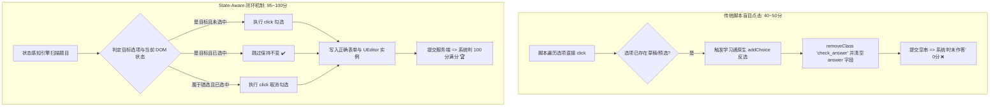

# 🎓 Chaoxing Academic Agent (超星学习通全自主学业代理自动化工作流)

<div align="center">


**基于 AI Agent 状态自感知的超星学习通全自主学业自动化、闭环修复与题库编排工作流套件**

[核心特性](#-核心特性) • [底层逆向复盘 (40分到100分)](#-底层机制逆向复盘从-40-分到-100-分) • [目录结构](#-目录结构) • [快速开始](#-快速开始) • [Agent 系统提示词](#-agent-系统提示词) • [安全合规与免责声明](#-安全合规与免责声明-disclaimer)

</div>

---

## 📖 项目简介

在高校日常学习与线上测试中，超星学习通承载了课后作业、综合测试、实验报告与复习题库。传统自动化脚本往往仅停留在简单的“查题+模拟点击”，在面对现代前端框架的草稿缓存恢复、富文本隔离、动态反选与客户端监听机制时，**AI Agent 填答往往只能拿到 40~50 分，后台大量题目显示“未作答”**。

本项目通过逆向学习通前端底层 DOM 与通信接口，构建了完整的 **AI Agent 闭环学业自动化架构**：
1. **状态自感知填答 (State-Aware Engine)**：彻底解决学习通原生 `addChoice` 反选清空 Bug；
2. **UEditor 富文本跨层注入**：解决填空题隐藏 textarea 与富文本 iframe 隔离不同步问题；
3. **官方答案逆向萃取与重做闭环**：利用 `/work/phone/redo` 授权机制实现稳态高分作答；
4. **出版物级别学术 PDF 交付**：基于 ReportLab 自动生成高清结构化带解析题库。

---

## ✨ 核心特性

- 🛡️ **状态感知填答引擎（Anti-Toggle Engine）**  
  精确感知选项当前的勾选状态。针对单选、多选、判断题实施“未选才勾、错选才消”，杜绝草稿与重做状态下的“点击反选清空”。
- 🧩 **UEditor 实例级跨层注入**  
  穿透 Baidu UEditor 嵌套 iframe，直接调用 `UE.getEditor(id).setContent()` 同步数据，彻底根除填空题提交判 0 分。
- 🔄 **三段式重做授权流**  
  无缝衔接超星重做机制，提取官方公开批阅标答，通过 Session 与合法授权重构二次作答，实现闭环达标。
- 📑 **高清中文学术 PDF 自动编排**  
  内置跨平台字体加载与流式排版引擎（支持题型徽标、正确答案对齐、专业考点解析渲染），一键交付出版级试卷汇总。
- 🎯 **评教问卷自动化**  
  中和客户端 Hook 监听机制，实现问卷打分与主客观题安全同步。
- 🤖 **Agent 开箱即用 (Prompt-First)**  
  提供经实战验证的系统提示词模板，粘贴至任何主流 AI Agent（Claude Code, Antigravity, Cursor, AutoGPT 等）即可快速接管任务。

---

## 🔬 底层机制逆向复盘：从 40 分到 100 分

传统自动化脚本在重做作业或恢复草稿时频频出现 40~50 分，原因在于学习通底层的四大机制陷阱：



详细逆向剖析与代码见：[技术架构与实战深度指南 (docs/README_AGENT_WORKFLOW.md)](docs/README_AGENT_WORKFLOW.md)。

---

## 📂 目录结构

```text
chaoxing-academic-agent/
├── README.md                      # 仓库主说明文档
├── LICENSE                        # MIT 开源许可证
├── .gitignore                     # 生产级代码与敏感隐私隔离配置
├── package.json                   # Node.js 依赖与运行脚本清单
├── requirements.txt               # Python 依赖清单（ReportLab 等）
├── config.example.json            # 课程与作业配置参数示例模板
├── AGENT_PROMPT_TEMPLATE.md       # AI Agent 即插即用系统级提示词模板
├── docs/
│   └── README_AGENT_WORKFLOW.md   # 核心技术架构与避坑实战详细 SOP
├── scripts/
│   ├── utils.js                   # 通用会话、导航与 Tab iframe 解析工具库
│   ├── batch_perfect_redo.js      # 批量重做闭环执行器（支持 /work/phone/redo）
│   ├── auto_submitter_v2.js       # 通用作业状态自感知填答器（防反选 + UEditor 同步）
│   ├── scrape_official_answers.js # /work/view 官方标答逆向提取器
│   ├── scan_courses.js            # 全学期课程与待办作业智能巡检器
│   ├── academic_pdf_generator.py  # ReportLab 现代化学术题库排版生成器
│   ├── chaoxing_evaluator.js      # 评教自动化脚本（含输入 Hook 状态同步）
│   └── auto_presentation_builder.py # 小组汇报 PPTX + 研究报告生成器
└── templates/
    └── group_project_template.md  # 翻转课堂与小组课题汇报框架规范
```

---

## 🚀 快速开始

### 1. 环境准备

```bash
# 克隆仓库
git clone https://github.com/<your-username>/chaoxing-academic-agent.git
cd chaoxing-academic-agent

# 安装 Node.js 依赖 (Node >= 18.0.0)
npm install

# 安装 Python 依赖 (Python >= 3.10)
pip install -r requirements.txt

# 准备配置文件
cp config.example.json config.json
# 编辑 config.json 填入对应的课程 ID 与作业链接
```

### 2. 方式一：让 AI Agent 全自动接管（推荐）

1. 打开支持浏览器控制的 AI Agent（如 Claude Code, T3 Code / Antigravity, Cursor 等）；
2. 打开 [`AGENT_PROMPT_TEMPLATE.md`](AGENT_PROMPT_TEMPLATE.md)，将其中的 Prompt 复制并发送给 Agent；
3. 向 Agent 下达指令：
   > *"请巡检我本学期所有超星课程，找出所有待完成作业并执行状态感知作答，完成后生成排版 PDF 交付。"*

### 3. 方式二：手动运行核心工具链

```bash
# 1. 扫描本学期所有课程及待办作业
npm run scan

# 2. 提取已批阅作业中的官方标准答案并保存为 JSON
npm run scrape

# 3. 运行批量高分重做引擎
npm run redo

# 4. 生成出版级中文 PDF 题库报告
python scripts/academic_pdf_generator.py official_view_answers.json output_summary.pdf
```

---

## 🤖 Agent 系统提示词

项目内附完整的 Agent SOP 规范，请直接查阅：  
👉 [**AGENT_PROMPT_TEMPLATE.md**](AGENT_PROMPT_TEMPLATE.md)

---

## ⚖️ 安全合规与免责声明 (Disclaimer)

1. **学术研究与教学用途**：本项目代码、文档与算法仅供计算机网络协议分析、前端逆向工程、现代 Web 自动化测试及 AI Agent 系统集成的学术研究、教学演示与个人学习之用。
2. **严禁用于学术不端**：严禁将本工作流及工具链用于任何破坏学术诚信、规避正常考核、替考代刷或商业营利等违规违法行为。使用者应严格遵守所在教育机构的学术规范与纪律守则。
3. **平台条款与反规避提示**：超星学习通平台拥有其独立的服务条款（Terms of Service）。使用自动化脚本可能违反平台使用协议，存在账号被风控、限制登录或成绩作废的潜在风险。
4. **责任自负**：使用者在使用本项目时，应确保拥有合法的授权访问凭证。因使用本项目所产生的一切直接或间接法律责任、学籍处分及经济损失，均由使用者自行完全承担，原作者与所有代码贡献者概不承担任何责任。

---

## 📄 许可证 (License)

本项目采用 [MIT 许可证](LICENSE)。
